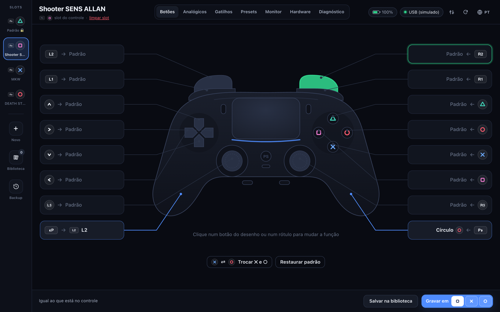
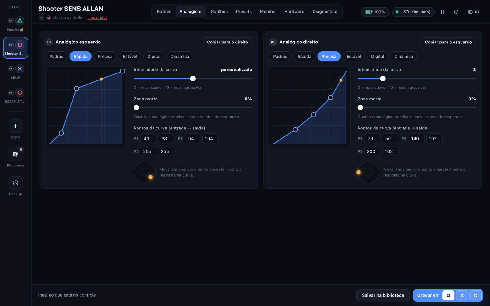
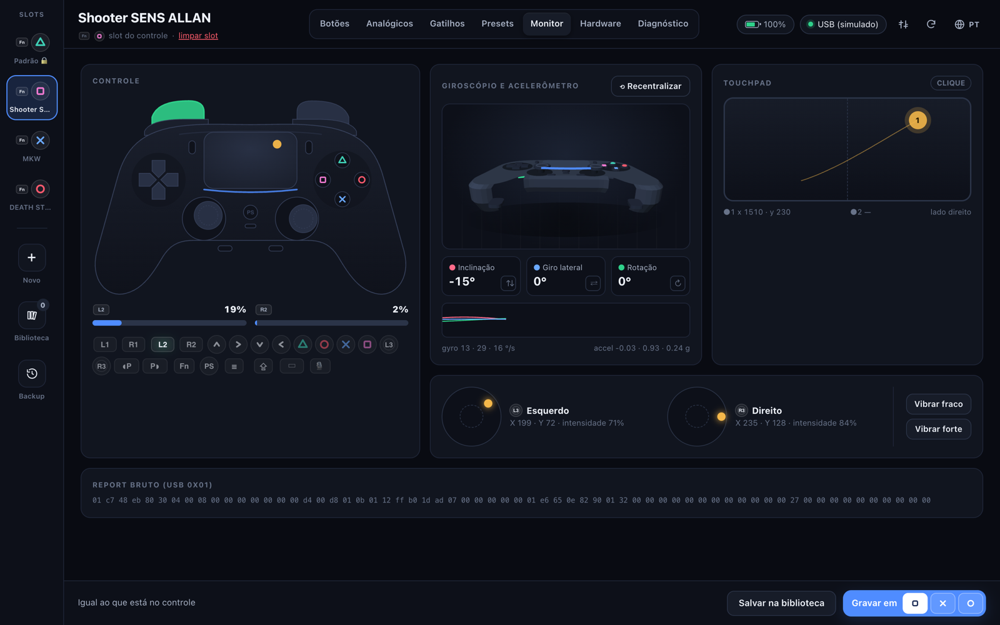
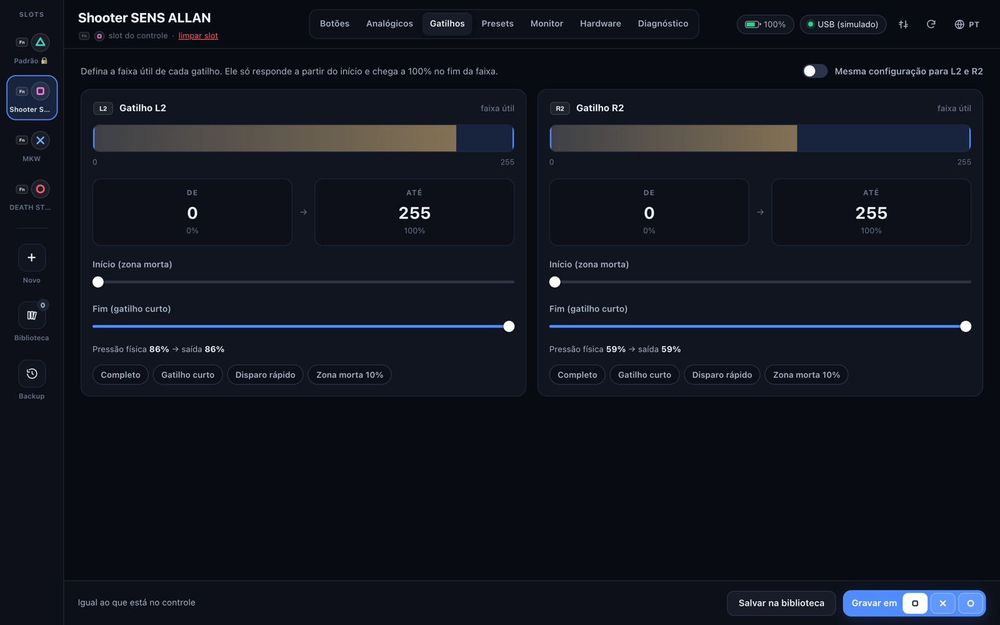
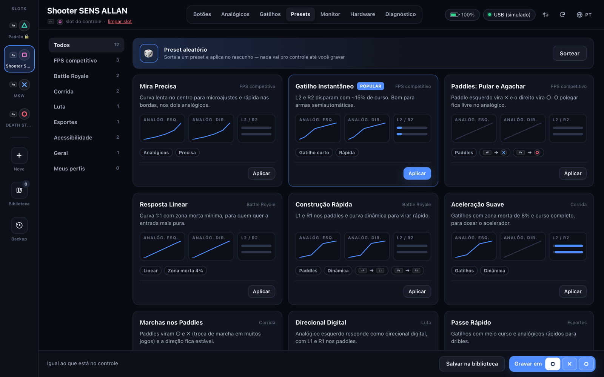
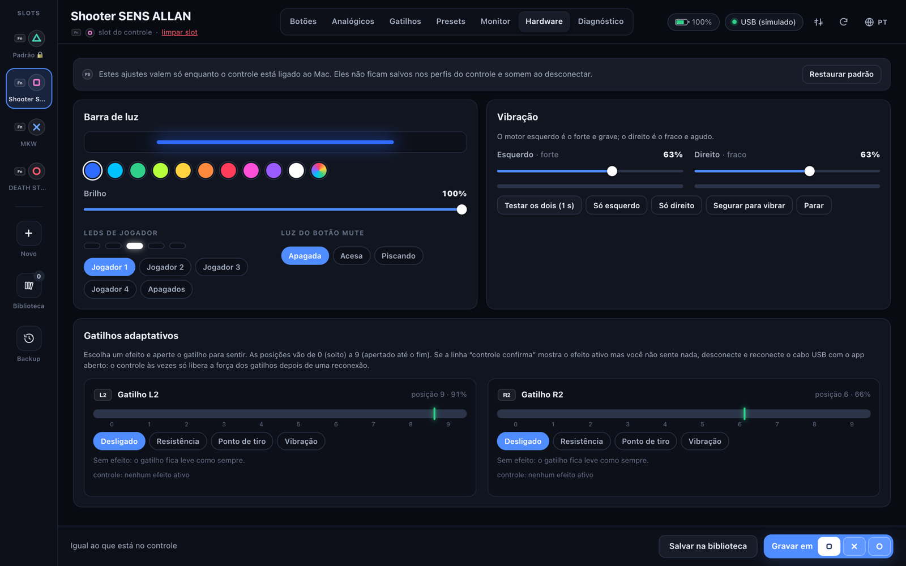
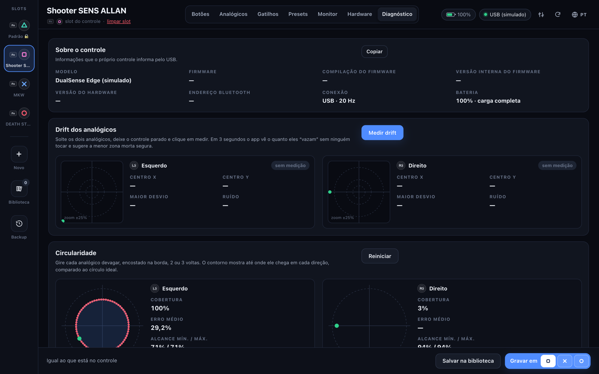
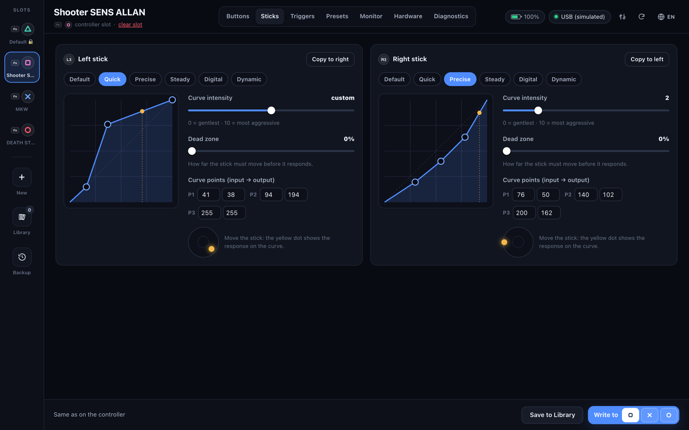
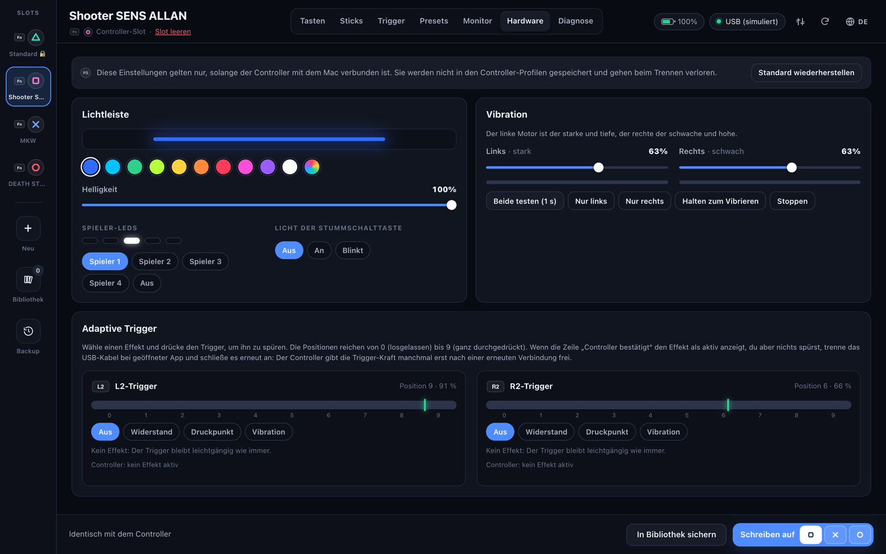

<p align="center">
  
</p>

<h1 align="center">DualSense Edge Studio</h1>

<p align="center">
  App nativo de macOS para editar os perfis personalizados do controle <b>DualSense Edge</b>, sem PS5 e sem navegador.
</p>

<p align="center">
  
  
  
</p>



## Sumário

- [O que dá para fazer](#o-que-dá-para-fazer)
- [Capturas de tela](#capturas-de-tela)
- [Requisitos](#requisitos)
- [Instalação](#instalação)
- [Uso rápido](#uso-rápido)
- [Segurança](#segurança)
- [Estrutura do projeto](#estrutura-do-projeto)
- [Documentação](#documentação)
- [Protocolo (resumo)](#protocolo-resumo)

## O que dá para fazer

- **Criar perfis novos** sem mexer nos slots (botão ＋ ou ⌘N). Eles ficam na biblioteca do app e podem ser gravados no controle depois, pelo botão "Gravar em □ ✕ ○".
- **Ler os 4 slots do controle** (FN + △ □ ✕ ○), gravar e limpar □ ✕ ○. O slot △ é o perfil padrão e só pode ser lido.
- **Botões**: desenho do controle com uma linha ligando cada botão à função dele. Clique num botão do desenho ou num rótulo para remapear, ou abra o seletor e aperte o botão desejado no controle. Os 16 botões podem ser remapeados, incluindo os paddles.
- **Analógicos**: as 6 curvas do PS5, intensidade, zona morta e uma curva livre arrastando os pontos, com a resposta ao vivo.
- **Gatilhos**: faixa útil de L2/R2, com a opção de usar a mesma configuração nos dois.
- **Presets**: modelos por categoria (FPS, Battle Royale, Corrida, Luta, Esportes, Acessibilidade), sorteio de preset e aplicação das configurações de outro perfil da biblioteca. Um preset muda só o rascunho; nada vai para o controle até você gravar.
- **Monitor ao vivo**: o controle aceso conforme o uso; giroscópio com um controle em 3D, inclinação, rotação e gráfico dos eixos; touchpad com até 2 dedos, rastro e clique; analógicos, gatilhos, todos os botões, report bruto e vibração.
- **Hardware**: cor e brilho da barra de luz, LEDs de jogador, luz do mute, vibração com os dois motores separados e efeitos dos gatilhos adaptativos (resistência, ponto de tiro e vibração). Vale só enquanto o controle está ligado; nada disso fica nos perfis.
- **Diagnóstico**: mede o drift dos analógicos e sugere a zona morta (aplica no perfil com um clique), testa a circularidade, mostra a faixa real de L2/R2 e a taxa de reports do USB (1000 Hz no Edge).
- **Backup e histórico**: salva os 4 slots num arquivo e restaura tudo de uma vez. Antes de cada gravação, limpeza ou restauração, o app guarda uma cópia do slot no histórico, e dá para desfazer com um clique.
- **Comparar perfis**: dois perfis lado a lado (o perfil aberto, os slots, a biblioteca ou uma cópia do histórico), com as diferenças destacadas. Os botões "Copiar B → A" levam uma parte, ou tudo, para A.
- **Barra de menus**: ícone com a bateria do controle e o perfil ativo, aviso de bateria fraca (20% e 10%) e opção de continuar rodando só na barra de menus ao fechar a janela.
- **Sobre o controle** (aba Diagnóstico): versão e data do firmware, versão do hardware, endereço Bluetooth, taxa de USB e bateria.
- **Biblioteca** em `~/Library/Application Support/DualSense Edge Studio/`, com busca, duplicar, excluir e importar/exportar JSON. O formato é compatível com o [edge-config.com](https://edge-config.com).
- **9 idiomas**: português, inglês, espanhol, francês, alemão, italiano, russo, chinês simplificado e japonês. O app abre no idioma do sistema, e o botão 🌐 no canto superior direito troca o idioma a qualquer momento.
- **Atalhos**: ⌘N cria um perfil novo, ⌘S salva na biblioteca e ⌘1–⌘7 trocam de aba.

## Capturas de tela

| Analógicos | Monitor ao vivo |
|---|---|
|  |  |
| **Gatilhos** | **Presets** |
|  |  |
| **Hardware** | **Diagnóstico** |
|  |  |

> As capturas foram feitas no modo simulador (interface aberta no navegador, com dados de exemplo).

### Em outros idiomas

| English | 日本語 | Deutsch |
|---|---|---|
|  |  |  |

## Requisitos

- Controle ligado **por cabo USB**. Por Bluetooth os perfis não podem ser editados, assim como no PS5.
- macOS 12 (Monterey) ou mais recente, Apple Silicon ou Intel.
- Para compilar: só as Command Line Tools da Apple (`xcode-select --install`).

## Instalação

O app não é distribuído assinado pela Apple, então a forma recomendada é compilar a partir do código:

```bash
git clone https://github.com/samaBR85/DSEdge-Studio.git
```

```bash
cd DSEdge-Studio && ./build.sh
```

O app fica em `build/DualSense Edge Studio.app`. Arraste-o para a pasta Aplicativos se quiser.

Se o macOS bloquear o acesso ao controle, libere o app em *Ajustes do Sistema › Privacidade e Segurança › Monitoramento de Entrada*. Detalhes e solução de problemas em [docs/USO.md](docs/USO.md#solução-de-problemas).

## Uso rápido

1. Ligue o DualSense Edge no Mac pelo cabo USB e abra o app.
2. Escolha um slot na barra lateral (□ ✕ ○) ou crie um perfil novo com ⌘N.
3. Ajuste botões, analógicos e gatilhos nas abas.
4. Clique em **Gravar em □ / ✕ / ○** para mandar o perfil ao controle. Uma cópia do conteúdo anterior vai para o histórico, então dá para desfazer.
5. No controle, troque de perfil com **FN + □ / ✕ / ○**.

O guia completo, aba por aba, está em [docs/USO.md](docs/USO.md).

## Segurança

- A parte nativa só aceita escrever nos feature reports de perfil (`0x60`–`0x63`) e de limpar slot (`0x68`), e no output report `0x02` (luz, vibração e gatilhos, que não ficam gravados). Qualquer outro report é recusado antes de chegar ao controle.
- O slot △ (perfil padrão) nunca é gravado nem limpo pela interface.
- Antes de cada gravação, limpeza ou restauração, o app guarda uma cópia do slot no histórico.
- Os campos que o app não edita são preservados: ao regravar, ele parte dos bytes originais lidos do controle.

## Estrutura do projeto

```
.
├── build.sh            # compila o .app universal (arm64 + x86_64)
├── src/main.m          # parte nativa: IOKit HID, janela, WKWebView, barra de menus
├── web/                # interface (HTML/CSS/JS puro, sem build)
│   ├── index.html, app.css, app.js
│   ├── i18n.js         # idiomas: T(), detecção e seletor
│   ├── i18n/           # traduções (en, es, fr, de, it, ru, zh, ja)
│   ├── proto.js        # codificação/decodificação dos perfis, CRC32
│   ├── native.js       # ponte JS ↔ nativo (ou simulador no navegador)
│   ├── controller.js, model3d.js
│   ├── presets.js, diag.js, compare.js, backup.js, hw.js
├── assets/             # ícone do app (.icns)
├── scripts/            # i18n_check.py: confere as traduções
├── mockups/            # estudos de layout da interface
└── docs/               # documentação e capturas de tela
```

| Arquivo | Função |
|---|---|
| `src/main.m` | Parte nativa: acesso HID via IOKit, janela, WKWebView, ponte JS ↔ nativo, barra de menus e notificações. |
| `web/proto.js` | Protocolo dos perfis: codifica e decodifica os feature reports, CRC32, curvas e input report. |
| `web/app.js`, `web/app.css`, `web/index.html` | Interface principal. |
| `web/controller.js` | Desenho do controle e ícones dos botões em SVG. |
| `web/model3d.js` | Controle em 3D do monitor de giroscópio. |
| `web/presets.js` | Presets prontos. |
| `web/diag.js` | Aba Diagnóstico. |
| `web/compare.js` | Comparação de perfis. |
| `web/backup.js` | Backup dos slots e histórico de gravações. |
| `web/hw.js` | Aba Hardware (output report `0x02`). |
| `web/native.js` | Ponte com o app. No navegador, roda um simulador com dados de exemplo. |
| `web/i18n.js`, `web/i18n/*.js` | Idiomas: função `T()`, detecção do idioma do sistema, seletor e traduções. |
| `scripts/i18n_check.py` | Confere se todas as traduções estão completas e com os mesmos marcadores. |

## Documentação

| Documento | Conteúdo |
|---|---|
| [docs/USO.md](docs/USO.md) | Guia do usuário, aba por aba, e solução de problemas. |
| [docs/ARQUITETURA.md](docs/ARQUITETURA.md) | Como a parte nativa e a interface conversam, comandos da ponte e arquivos salvos. |
| [docs/PROTOCOLO.md](docs/PROTOCOLO.md) | Formato byte a byte dos perfis, CRCs, input report e output report. |
| [docs/DESENVOLVIMENTO.md](docs/DESENVOLVIMENTO.md) | Como compilar, rodar a interface no navegador e contribuir. |
| [CHANGELOG.md](CHANGELOG.md) | Histórico de versões. |

## Protocolo (resumo)

| Operação | Report |
|---|---|
| Ler slots | Feature `0x70`–`0x7B`: 3 reports por slot, na ordem △ □ ✕ ○ |
| Gravar slot | Feature `0x60` □, `0x61` ✕, `0x62` ○ (`0x63` △): 3 partes, com CRC32 do perfil e CRC32 por report (semente `0xA3`) |
| Limpar slot | Feature `0x68`, byte 1 = 2 □, 3 ✕, 4 ○ |
| Luz, LEDs, vibração e gatilhos adaptativos | Output `0x02` (só esse report de saída é aceito) |

Validação feita com um controle real: ler um perfil gravado pelo PS5 e codificá-lo de novo gera exatamente os mesmos bytes, com o mesmo CRC. Regravar um perfil e relê-lo também devolve os mesmos bytes. Detalhes em [docs/PROTOCOLO.md](docs/PROTOCOLO.md).

## Aviso

Projeto independente, sem relação com a Sony Interactive Entertainment. "PlayStation", "DualSense" e "DualSense Edge" são marcas da Sony. Use por sua conta e risco: gravar perfis altera a memória do controle (o slot △ e o firmware nunca são tocados).
