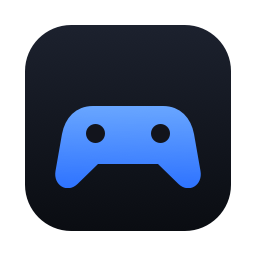
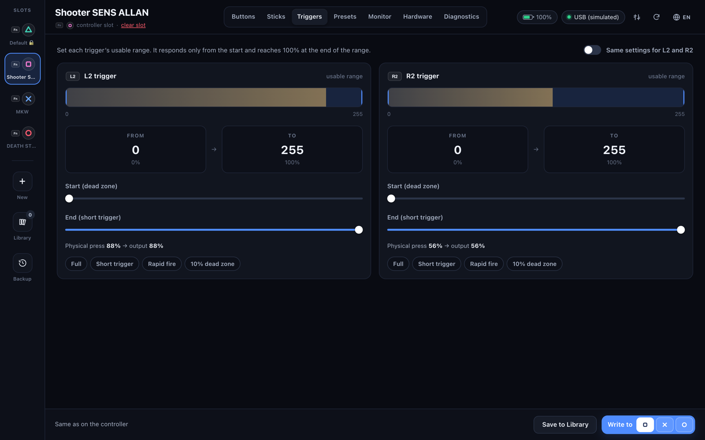
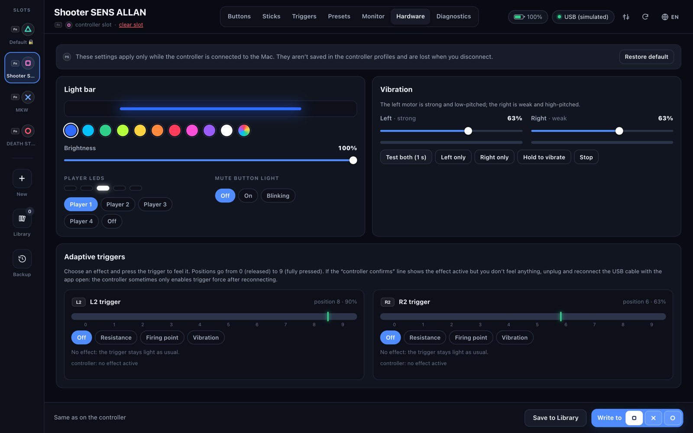
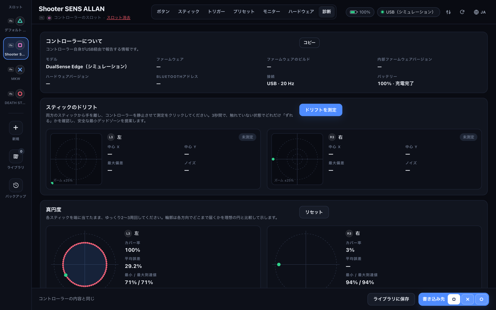

<p align="center">
  
</p>

<h1 align="center">DualSense Edge Studio</h1>

<p align="center">
  A native macOS app for editing the custom profiles of the <b>DualSense Edge</b> controller — no PS5 and no browser needed.
</p>

<p align="center">
  
  
  
  
</p>


## Contents

- [Features](#features)
- [Screenshots](#screenshots)
- [Requirements](#requirements)
- [Installation](#installation)
- [Quick start](#quick-start)
- [Languages](#languages)
- [Safety](#safety)
- [Project structure](#project-structure)
- [Documentation](#documentation)
- [Protocol summary](#protocol-summary)
- [Disclaimer](#disclaimer)

## Features

- **Create new profiles** without touching the controller slots (＋ button or ⌘N). They live in the app's library and can be written to the controller later with the "Write to □ ✕ ○" button.
- **Read all 4 controller slots** (FN + △ □ ✕ ○), and write or clear □ ✕ ○. The △ slot is the default profile and is read-only.
- **Buttons**: a drawing of the controller with a line connecting each button to its function. Click a button on the drawing or a label to remap it, or open the picker and press the button you want on the controller. All 16 buttons can be remapped, including the back paddles.
- **Sticks**: the 6 PS5 response curves, curve intensity, dead zone and a free-form curve you shape by dragging points, with a live response preview.
- **Triggers**: the usable range of L2/R2, optionally linked so both use the same settings.
- **Presets**: templates by category (FPS, Battle Royale, Racing, Fighting, Sports, Accessibility), a random preset, and applying the settings of another profile from the library. A preset only changes the draft; nothing reaches the controller until you write it.
- **Live monitor**: the controller lights up as you use it; gyroscope with a 3D controller, pitch, roll, yaw and an axis graph; touchpad with up to 2 fingers, trails and click; sticks, triggers, every button, the raw report and rumble.
- **Hardware**: light bar color and brightness, player LEDs, mute LED, rumble with each motor controlled separately, and adaptive trigger effects (resistance, weapon trigger and vibration). These apply only while the controller is connected; none of it is stored in the profiles.
- **Diagnostics**: measures stick drift and suggests a dead zone (applied to the profile with one click), tests stick circularity, shows the real L2/R2 range and the USB report rate (1000 Hz on the Edge).
- **Backup & history**: saves all 4 slots to a file and restores them in one go. Before every write, clear or restore, the app keeps a copy of the slot in the history, so you can undo with one click.
- **Compare profiles**: two profiles side by side (the open profile, a slot, a library profile or a history copy) with the differences highlighted. The "Copy B → A" buttons bring one part, or everything, over to A.
- **Menu bar**: an icon with the controller's battery and active profile, low-battery alerts (20% and 10%), and an option to keep running in the menu bar when the window is closed.
- **About the controller** (Diagnostics tab): firmware version and build date, hardware version, Bluetooth address, USB rate and battery.
- **Library** in `~/Library/Application Support/DualSense Edge Studio/`, with search, duplicate, delete and JSON import/export. The format is compatible with [edge-config.com](https://edge-config.com).
- **9 languages**: English, Portuguese, Spanish, French, German, Italian, Russian, Simplified Chinese and Japanese. The app starts in the system language, and the 🌐 button in the top-right corner switches language at any time.
- **Shortcuts**: ⌘N creates a new profile, ⌘S saves to the library and ⌘1–⌘7 switch tabs.

## Screenshots

| Sticks | Live monitor |
|---|---|
|  |  |
| **Triggers** | **Presets** |
|  |  |
| **Hardware** | **Diagnostics** |
|  |  |

> Screenshots were taken in simulator mode (the UI opened in a browser with sample data).

### In other languages

| Português | 日本語 | Deutsch |
|---|---|---|
|  |  |  |

## Requirements

- The controller connected **with a USB cable**. Profiles can't be edited over Bluetooth, just like on the PS5.
- macOS 12 (Monterey) or later, on Apple Silicon or Intel.
- To build: only Apple's Command Line Tools (`xcode-select --install`).

## Installation

The app isn't signed or notarized by Apple, so the recommended way is to build it from source:

```bash
git clone https://github.com/samaBR85/DSEdge-Studio.git
```

```bash
cd DSEdge-Studio && ./build.sh
```

The app is created at `build/DualSense Edge Studio.app`. Drag it to your Applications folder if you like.

If macOS blocks access to the controller, allow the app in *System Settings › Privacy & Security › Input Monitoring*. More details and troubleshooting are in the [user guide](docs/USO.md#solução-de-problemas) (Portuguese).

## Quick start

1. Connect the DualSense Edge to your Mac with a USB cable and open the app.
2. Pick a slot in the sidebar (□ ✕ ○) or create a new profile with ⌘N.
3. Adjust buttons, sticks and triggers in the tabs.
4. Click **Write to □ / ✕ / ○** to send the profile to the controller. A copy of the previous contents goes to the history, so you can undo.
5. On the controller, switch profiles with **FN + □ / ✕ / ○**.

## Languages

The app opens in the first macOS preferred language it supports, falling back to English. Use the 🌐 button in the top-right corner to pick a language; the choice is saved, and **System language** goes back to following macOS. The menus, the menu-bar item and the notifications switch along with the window.

Strings are written in Portuguese in the code (`T("…")` in JavaScript, `L(@"…")` in Objective-C) and translated in `web/i18n/<code>.js`. After changing any text, run:

```bash
python3 scripts/i18n_check.py
```

It lists missing translations and any translation whose `{placeholders}` or HTML tags don't match.

## Safety

- The native layer only accepts writes to the profile feature reports (`0x60`–`0x63`), the clear-slot report (`0x68`) and the output report `0x02` (lights, rumble and triggers, which aren't stored). Any other report is rejected before it reaches the controller.
- The △ slot (default profile) is never written or cleared by the UI.
- Before every write, clear or restore, the app keeps a copy of the slot in the history.
- Fields the app doesn't edit are preserved: when writing, it starts from the original bytes read from the controller.

## Project structure

```
.
├── build.sh            # builds the universal .app (arm64 + x86_64)
├── src/main.m          # native layer: IOKit HID, window, WKWebView, menu bar
├── web/                # UI (plain HTML/CSS/JS, no build step)
│   ├── index.html, app.css, app.js
│   ├── i18n.js         # languages: T(), detection and picker
│   ├── i18n/           # translations (en, es, fr, de, it, ru, zh, ja)
│   ├── proto.js        # profile encoding/decoding, CRC32
│   ├── native.js       # JS ↔ native bridge (or a simulator in the browser)
│   ├── controller.js, model3d.js
│   ├── presets.js, diag.js, compare.js, backup.js, hw.js
├── assets/             # app icon (.icns)
├── scripts/            # i18n_check.py: checks the translations
├── mockups/            # UI layout studies
└── docs/               # documentation and screenshots
```

| File | Purpose |
|---|---|
| `src/main.m` | Native layer: HID access via IOKit, window, WKWebView, JS ↔ native bridge, menu bar and notifications. |
| `web/proto.js` | Profile protocol: encodes and decodes the feature reports, CRC32, curves and the input report. |
| `web/app.js`, `web/app.css`, `web/index.html` | Main UI. |
| `web/controller.js` | SVG controller drawing and button glyphs. |
| `web/model3d.js` | 3D controller for the gyro monitor. |
| `web/presets.js` | Built-in presets. |
| `web/diag.js` | Diagnostics tab. |
| `web/compare.js` | Profile comparison. |
| `web/backup.js` | Slot backup and write history. |
| `web/hw.js` | Hardware tab (output report `0x02`). |
| `web/native.js` | Bridge to the app. In a browser it runs a simulator with sample data. |
| `web/i18n.js`, `web/i18n/*.js` | Languages: the `T()` function, system language detection, picker and translations. |
| `scripts/i18n_check.py` | Checks that every translation is complete and has the same placeholders. |

## Documentation

The detailed guides are in Portuguese:

| Document | Contents |
|---|---|
| [docs/USO.md](docs/USO.md) | User guide, tab by tab, and troubleshooting. |
| [docs/ARQUITETURA.md](docs/ARQUITETURA.md) | How the native layer and the UI talk, bridge commands, languages and saved files. |
| [docs/PROTOCOLO.md](docs/PROTOCOLO.md) | Byte-by-byte profile format, CRCs, input report and output report. |
| [docs/DESENVOLVIMENTO.md](docs/DESENVOLVIMENTO.md) | Building, running the UI in a browser, translations and contributing. |
| [CHANGELOG.md](CHANGELOG.md) | Version history. |

## Protocol summary

| Operation | Report |
|---|---|
| Read slots | Feature `0x70`–`0x7B`: 3 reports per slot, in the order △ □ ✕ ○ |
| Write slot | Feature `0x60` □, `0x61` ✕, `0x62` ○ (`0x63` △): 3 parts, with a CRC32 of the profile and a CRC32 per report (seed `0xA3`) |
| Clear slot | Feature `0x68`, byte 1 = 2 □, 3 ✕, 4 ○ |
| Light bar, LEDs, rumble and adaptive triggers | Output `0x02` (the only output report accepted) |

Validated with a real controller: reading a profile saved by the PS5 and encoding it again produces exactly the same bytes, with the same CRC. Writing a profile and reading it back also returns the same bytes. Details in [docs/PROTOCOLO.md](docs/PROTOCOLO.md).

## Disclaimer

This is an independent project, not affiliated with Sony Interactive Entertainment. "PlayStation", "DualSense" and "DualSense Edge" are trademarks of Sony. Use at your own risk: writing profiles changes the controller's memory (the △ slot and the firmware are never touched).
