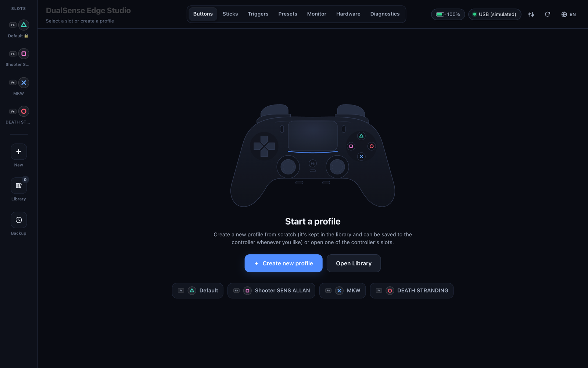
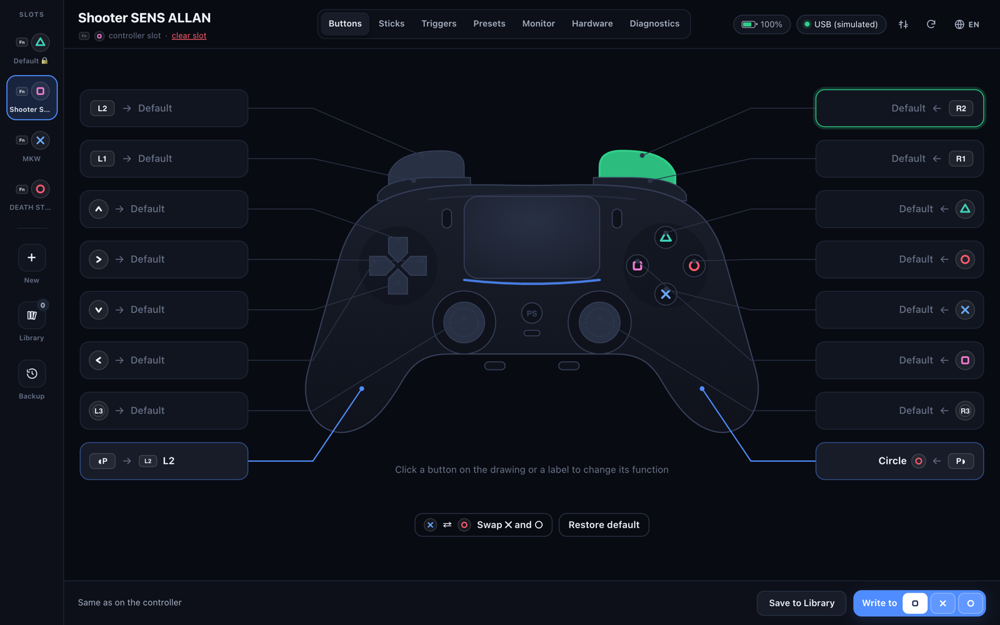
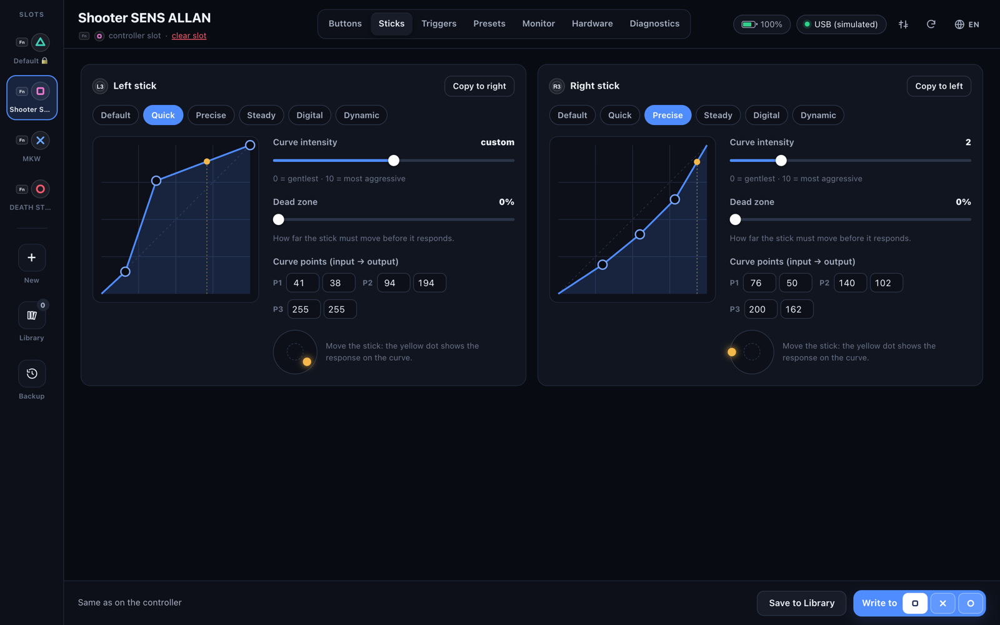
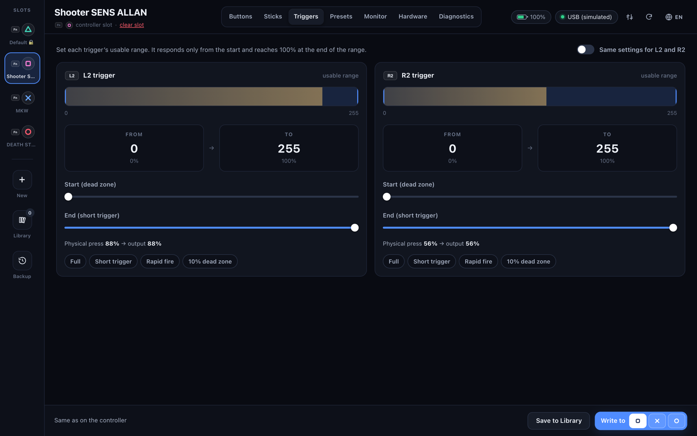
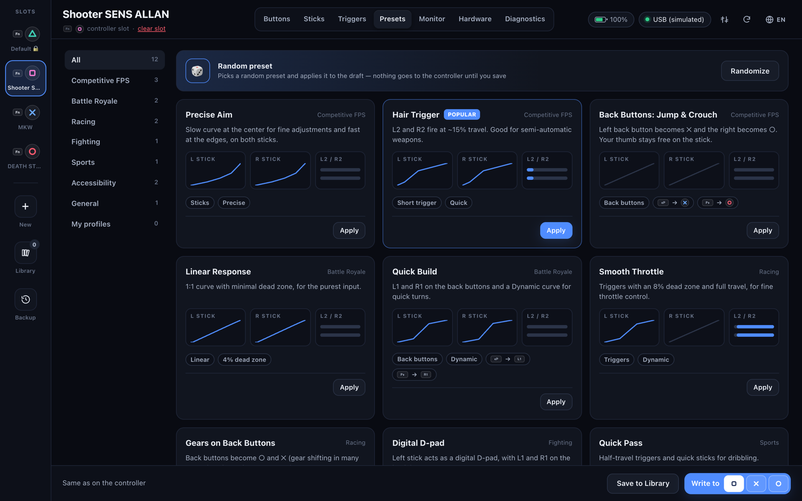
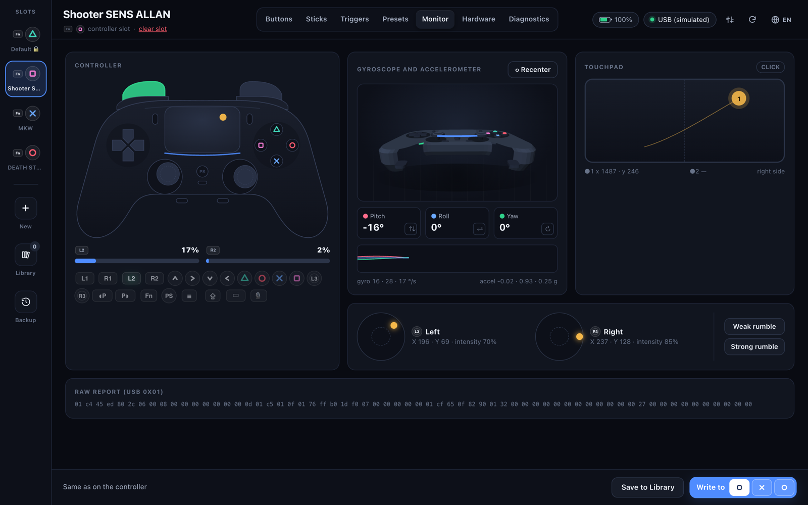
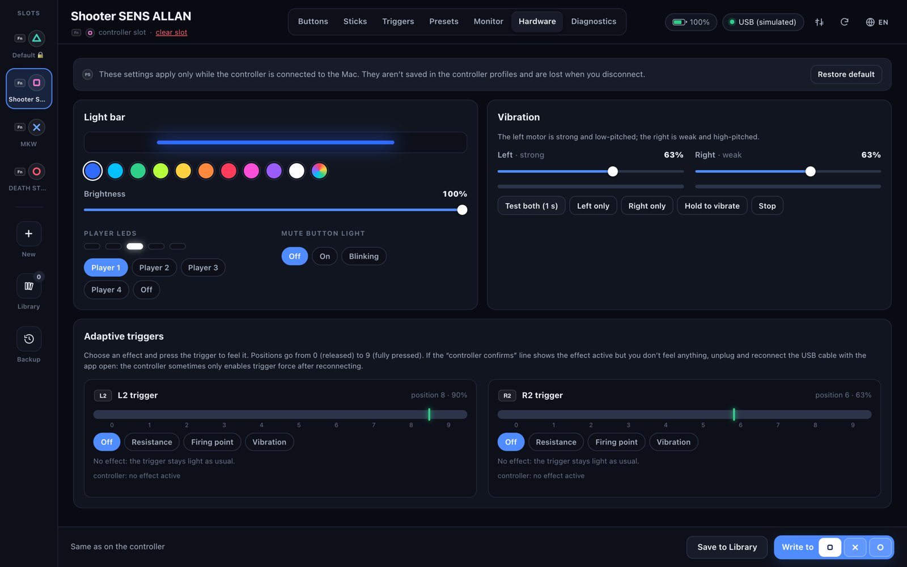
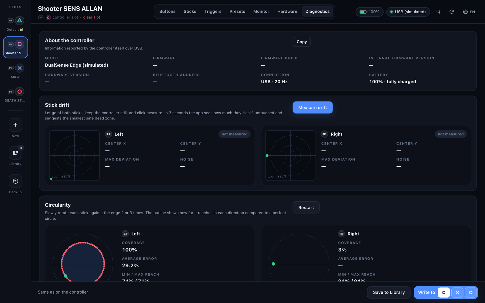

# User guide

This guide walks through every part of DualSense Edge Studio. For installation, see the [README](../README.md#installation).

## Concepts

- **Controller slots**: the DualSense Edge stores 4 profiles, selected with **FN + △ / □ / ✕ / ○**. The △ slot is the default profile: the app reads it but never writes or clears it.
- **Library**: profiles stored on the Mac, outside the controller. You can create, duplicate, search, import and export them.
- **Draft**: everything you change in the tabs stays in the app until you click **Write to □ / ✕ / ○** (controller) or **Save to Library** (⌘S). The bottom bar tells you when there are unwritten changes, and **Discard** goes back to the previous state.

## Language

The app opens in the system language (*System Settings › General › Language & Region*) when it's one of the 9 available: English, Portuguese, Spanish, French, German, Italian, Russian, Simplified Chinese and Japanese. For any other language it opens in English.

To switch, click the 🌐 button in the top-right corner and pick a language. The choice is saved; **System language** goes back to following macOS. The window reloads right away (if there are unwritten changes, the app asks first), and the menus, the menu-bar item and the notifications change too.

## Home screen

The sidebar shows the controller's 4 slots, the **New** button (⌘N), the **Library** and **Backup**. Along the top are the tabs (⌘1–⌘7), the battery, the connection status, the **Compare profiles** button, the button that reloads the slots, and the language picker.

## Buttons (⌘1)

Each label is connected by a line to its button on the drawing. To remap:

- click a button on the drawing or its label and choose the new function; or
- open the picker and press, on the controller, the button that should become the new function.

All 16 buttons can be remapped: the D-pad, △ ○ ✕ □, L1/L2/L3, R1/R2/R3 and the two back paddles. Shortcuts: **Swap ✕ and ○** and **Restore default**.

## Sticks (⌘2)

- **Curve**: the 6 PS5 types (Default, Quick, Precise, Steady, Digital, Dynamic).
- **Curve intensity**: from 0 (softest) to 10 (most aggressive), as on the PS5.
- **Dead zone**: how far the stick has to move before it responds.
- **Free-form curve**: drag points P1, P2 and P3 on the graph or type the values. The intensity then shows "custom".
- **Live response**: move the stick and the yellow dot shows where it lands on the curve.
- **Copy to right / Copy to left** copies one stick's settings to the other.

## Triggers (⌘3)

Sets the usable range of L2 and R2 (start and end of travel). With **Same settings for L2 and R2** turned on, changing one adjusts the other.

## Presets (⌘4)

Ready-made templates by category: Competitive FPS, Battle Royale, Racing, Fighting, Sports, Accessibility and General (factory defaults). You can also pick a random preset or apply the settings of another profile from the library. A preset only changes the draft; nothing reaches the controller until you write it.

## Monitor (⌘5)

Live readings from the controller:

- the controller drawing lights up as you use it, with L2/R2 pressure and every button (including FN, the paddles, PS, mute and the touchpad);
- gyroscope and accelerometer, with a 3D controller, pitch, roll, yaw and an axis graph (**Recenter** resets the yaw);
- touchpad with up to 2 fingers, trails and click;
- position and intensity of both sticks;
- **Weak rumble** / **Strong rumble** to test the motors;
- the raw report (USB `0x01`) in hexadecimal.

## Hardware (⌘6)

Settings that apply only while the controller is connected (none of this is stored in the profiles):

- light bar color and brightness;
- player LEDs (1 to 4) and their brightness;
- mute button light (off, on or blinking);
- rumble with each motor controlled separately (the left one is strong/slow, the right one weak/fast);
- adaptive trigger effects on L2 and R2: resistance, firing point (weapon) and vibration.

## Diagnostics (⌘7)

- **Stick drift**: measures how far the sticks wander at rest and suggests a dead zone, which can be applied to the profile with one click.
- **Circularity**: rotate the sticks along the edge to see their real reach.
- **Triggers**: shows the real range L2 and R2 reach.
- **Polling rate**: the USB report frequency (1000 Hz on the Edge), with average and jitter.
- **About the controller**: firmware version and build date, hardware version, Bluetooth address and battery.

## Compare profiles

A button at the top of the window. It puts two profiles side by side (the open profile, a slot, a library profile or a history copy) and highlights the differences in sticks, triggers and buttons. The **Copy B → A** buttons bring one part, or everything, over to A. If A is a slot or a library profile, it opens in the editor; nothing is written to the controller until you write it.

## Library

- Search, duplicate and delete profiles.
- **Export** creates an `edge-profiles-YYYY-MM-DD.json` file; **Import JSON** accepts files from this app and from [edge-config.com](https://edge-config.com).
- Files are stored in `~/Library/Application Support/DualSense Edge Studio/`.

## Backup & history

- **Save backup** writes all 4 slots to a file (`edge-backup-YYYY-MM-DD-HHMM.json`). **Restore…** writes everything back at once (the △ slot is left unchanged).
- Before every write, clear or restore, the app keeps a copy of the slot in the **History** (up to 60 entries). Each entry can be restored with one click or opened in the comparison.

## Menu bar

The menu-bar icon shows the battery and the active profile. In its menu:

- **Open DualSense Edge Studio**;
- **Keep running in the menu bar when the window is closed**: the app leaves the Dock and keeps monitoring the battery;
- **Notify when battery is low**: a notification at 20% and at 10%.

## Shortcuts

| Shortcut | Action |
|---|---|
| ⌘N | New profile |
| ⌘S | Save to Library |
| ⌘1 … ⌘7 | Buttons, Sticks, Triggers, Presets, Monitor, Hardware, Diagnostics |
| ⌘W | Close the window |
| ⌘Q | Quit |

## Troubleshooting

**"Searching…" and the controller doesn't show up**
- Make sure the cable carries data (some cables only charge).
- Profiles can only be read and written over **USB**. Over Bluetooth, the app tells you to plug in the cable.
- Quit other apps that may be using the controller (Steam, emulators, remapping tools).

**macOS blocks access**
Allow the app in *System Settings › Privacy & Security › Input Monitoring* and open it again.

**"The app can't be opened because it is from an unidentified developer"**
The release download is notarized by Apple and doesn't show this. A build made with `./build.sh` is signed only locally: it opens normally on the Mac that built it, but on another Mac you need to right-click it › **Open**, or allow it in *Privacy & Security*.

**The app icon is blank after rebuilding**
`build.sh` already asks Finder to reload the icon. If it stays blank, move the app to another folder and back, or relaunch Finder.

**Light or trigger effects disappear**
That's expected: Hardware tab settings aren't stored on the controller and are reset when it's turned off or when another app takes over the controller.
