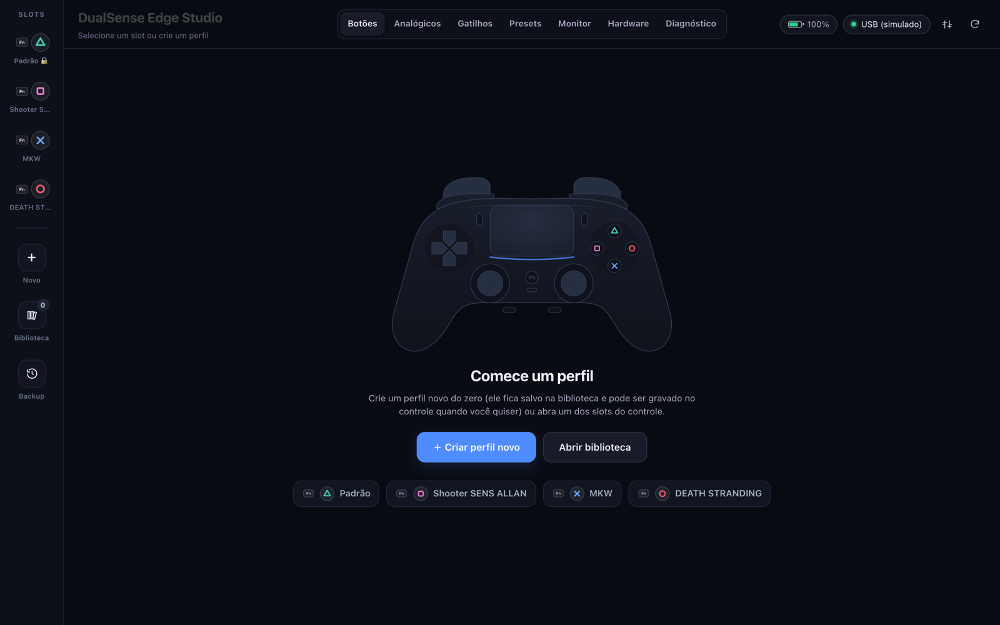
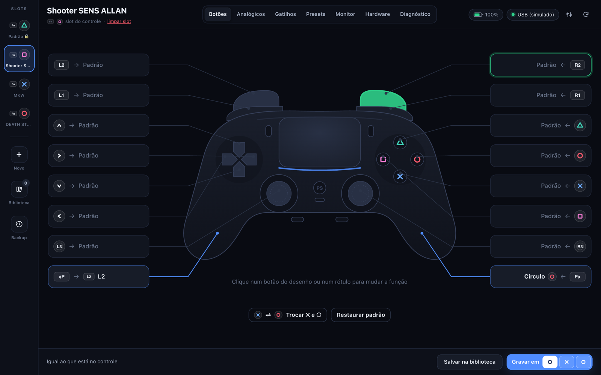
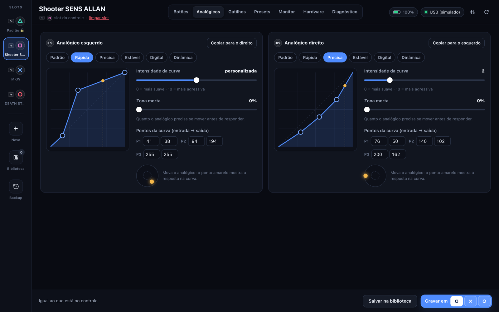
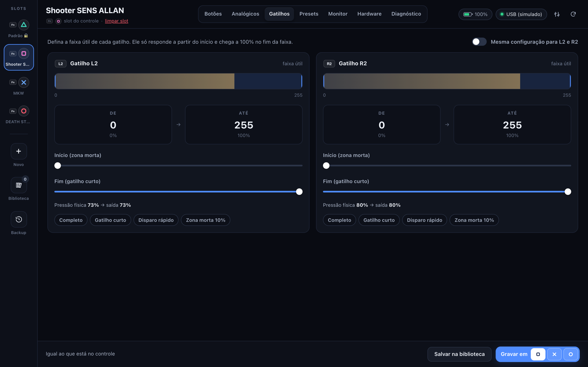
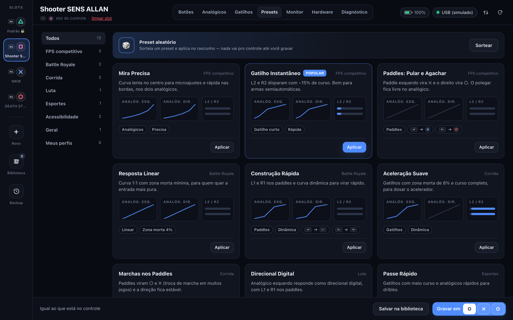
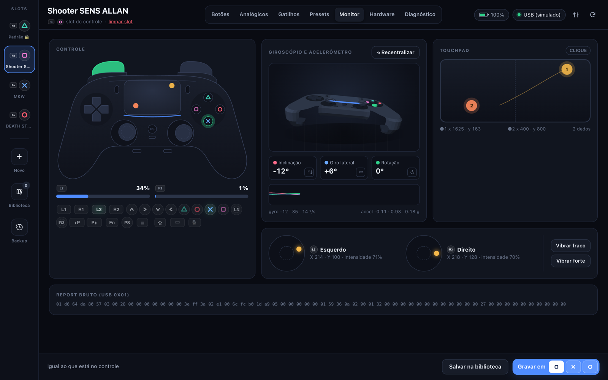
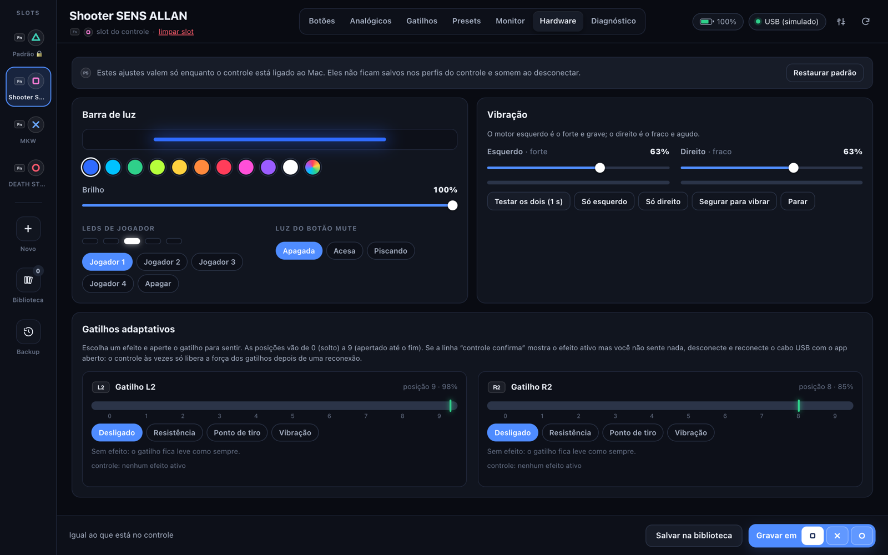
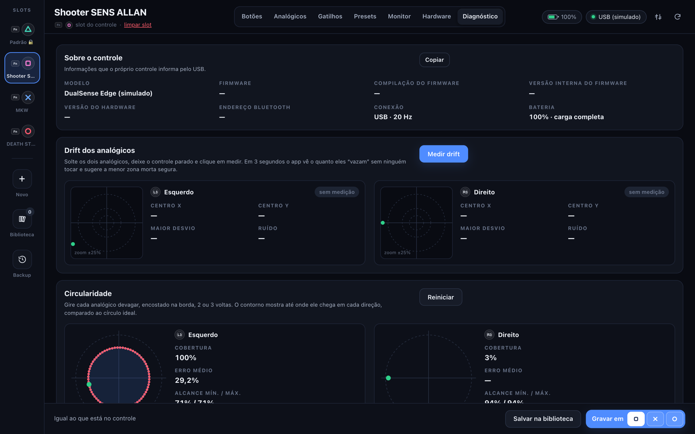

# Guia de uso

Este guia explica cada parte do DualSense Edge Studio. Para instalar, veja o [README](../README.md#instalação).

## Conceitos

- **Slots do controle**: o DualSense Edge guarda 4 perfis, escolhidos com **FN + △ / □ / ✕ / ○**. O slot △ é o perfil padrão: o app lê, mas não grava nem limpa.
- **Biblioteca**: perfis guardados no Mac, fora do controle. Dá para criar, duplicar, buscar, importar e exportar.
- **Rascunho**: tudo o que você muda nas abas fica só no app até você clicar em **Gravar em □ / ✕ / ○** (controle) ou **Salvar na biblioteca** (⌘S). A barra inferior avisa quando há alterações não gravadas, e **Descartar** volta ao estado anterior.

## Tela inicial

A barra lateral mostra os 4 slots do controle, o botão **Novo** (⌘N), a **Biblioteca** e o **Backup**. No topo ficam as abas (⌘1–⌘7), a bateria, o estado da conexão, o botão de **Comparar perfis** e o botão de recarregar os slots.

## Botões (⌘1)

Cada rótulo está ligado por uma linha ao botão correspondente no desenho. Para remapear:

- clique num botão do desenho ou no rótulo e escolha a nova função; ou
- abra o seletor e aperte, no controle, o botão que deve ser a nova função.

Os 16 botões podem ser remapeados: direcional, △ ○ ✕ □, L1/L2/L3, R1/R2/R3 e os dois paddles traseiros. Atalhos: **Trocar ✕ e ○** e **Restaurar padrão**.

## Analógicos (⌘2)

- **Curva**: os 6 tipos do PS5 (Padrão, Rápida, Precisa, Estável, Digital, Dinâmica).
- **Intensidade da curva**: de 0 (mais suave) a 10 (mais agressiva), como no PS5.
- **Zona morta**: quanto o analógico precisa se mover antes de responder.
- **Curva livre**: arraste os pontos P1, P2 e P3 no gráfico ou digite os valores. A intensidade passa a mostrar "personalizada".
- **Resposta ao vivo**: mexa o analógico e o ponto amarelo mostra onde ele cai na curva.
- **Copiar para o outro lado** leva a configuração de um analógico para o outro.

## Gatilhos (⌘3)

Define a faixa útil de L2 e R2 (início e fim do curso). Com a opção de usar a mesma configuração nos dois, mexer em um ajusta o outro.

## Presets (⌘4)

Modelos prontos por categoria: FPS competitivo, Battle Royale, Corrida, Luta, Esportes, Acessibilidade e Geral (padrão de fábrica). Também dá para sortear um preset ou aplicar as configurações de outro perfil da biblioteca. Um preset muda só o rascunho; nada vai para o controle até você gravar.

## Monitor (⌘5)

Leitura ao vivo do controle:

- desenho do controle aceso conforme o uso, com a pressão de L2/R2 e todos os botões (incluindo FN, paddles, PS, mute e touchpad);
- giroscópio e acelerômetro, com um controle em 3D, inclinação, giro lateral, rotação e gráfico dos eixos (**Recentralizar** zera o giro lateral);
- touchpad com até 2 dedos, rastro e clique;
- posição e intensidade dos dois analógicos;
- **Vibrar fraco** / **Vibrar forte** para testar os motores;
- report bruto (USB `0x01`) em hexadecimal.

## Hardware (⌘6)

Controles que valem só enquanto o controle está ligado (nada disso fica nos perfis):

- cor e brilho da barra de luz;
- LEDs de jogador (1 a 4) e brilho;
- luz do botão mute (apagada, acesa ou piscando);
- vibração com os dois motores separados (o esquerdo é o forte/lento, o direito o fraco/rápido);
- efeitos dos gatilhos adaptativos em L2 e R2: resistência, ponto de tiro (arma) e vibração.

## Diagnóstico (⌘7)

- **Drift**: mede o desvio dos analógicos parados e sugere uma zona morta, que pode ser aplicada no perfil com um clique.
- **Circularidade**: gire os analógicos encostando na borda para ver o alcance real.
- **Gatilhos**: mostra a faixa real que L2 e R2 alcançam.
- **Taxa de reports**: frequência do USB (1000 Hz no Edge), com média e variação.
- **Sobre o controle**: versão e data do firmware, versão do hardware, endereço Bluetooth e bateria.

## Comparar perfis

Botão no topo da janela. Coloca dois perfis lado a lado (o perfil aberto, um slot, um perfil da biblioteca ou uma cópia do histórico) e destaca as diferenças nos analógicos, gatilhos e botões. Os botões **Copiar B → A** levam uma parte, ou tudo, para A. Se A for um slot ou um perfil da biblioteca, ele é aberto no editor; nada é gravado no controle até você gravar.

## Biblioteca

- Busca, duplicar e excluir perfis.
- **Exportar** gera um arquivo `edge-profiles-AAAA-MM-DD.json`; **Importar** aceita arquivos do próprio app e do [edge-config.com](https://edge-config.com).
- Os arquivos ficam em `~/Library/Application Support/DualSense Edge Studio/`.

## Backup e histórico

- **Backup** salva os 4 slots num arquivo (`edge-backup-AAAA-MM-DD-HHMM.json`). **Restaurar** grava tudo de volta de uma vez (o slot △ não é alterado).
- Antes de cada gravação, limpeza ou restauração, o app guarda uma cópia do slot no **histórico** (até 60 entradas). Cada entrada pode ser restaurada com um clique ou aberta na comparação.

## Barra de menus

O ícone na barra de menus mostra a bateria e o perfil ativo. No menu:

- **Abrir DualSense Edge Studio**;
- **Continuar na barra de menus ao fechar a janela**: o app some do Dock e continua monitorando a bateria;
- **Avisar quando a bateria estiver fraca**: notificação em 20% e em 10%.

## Atalhos

| Atalho | Ação |
|---|---|
| ⌘N | Novo perfil |
| ⌘S | Salvar na biblioteca |
| ⌘1 … ⌘7 | Botões, Analógicos, Gatilhos, Presets, Monitor, Hardware, Diagnóstico |
| ⌘W | Fechar a janela |
| ⌘Q | Encerrar |

## Solução de problemas

**"Procurando…" e o controle não aparece**
- Confira se o cabo transmite dados (alguns cabos só carregam).
- Os perfis só podem ser lidos e gravados por **USB**. Por Bluetooth o app avisa que é preciso ligar o cabo.
- Feche outros apps que possam estar usando o controle (Steam, emuladores, ferramentas de remapeamento).

**O macOS bloqueia o acesso**
Libere o app em *Ajustes do Sistema › Privacidade e Segurança › Monitoramento de Entrada* e abra o app de novo.

**"O app não pode ser aberto porque é de um desenvolvedor não identificado"**
O app é assinado de forma local (ad-hoc). Se você mesmo compilou, ele abre normalmente. Se recebeu o `.app` de outra pessoa, clique com o botão direito › **Abrir**, ou libere em *Privacidade e Segurança*.

**O ícone do app aparece em branco depois de recompilar**
O `build.sh` já pede ao Finder para reler o ícone. Se continuar em branco, mova o app para outra pasta e volte, ou reinicie o Finder.

**Os efeitos de luz/gatilho somem**
É o esperado: as configurações da aba Hardware não ficam no controle e são desfeitas quando ele é desligado ou quando outro app assume o controle.
